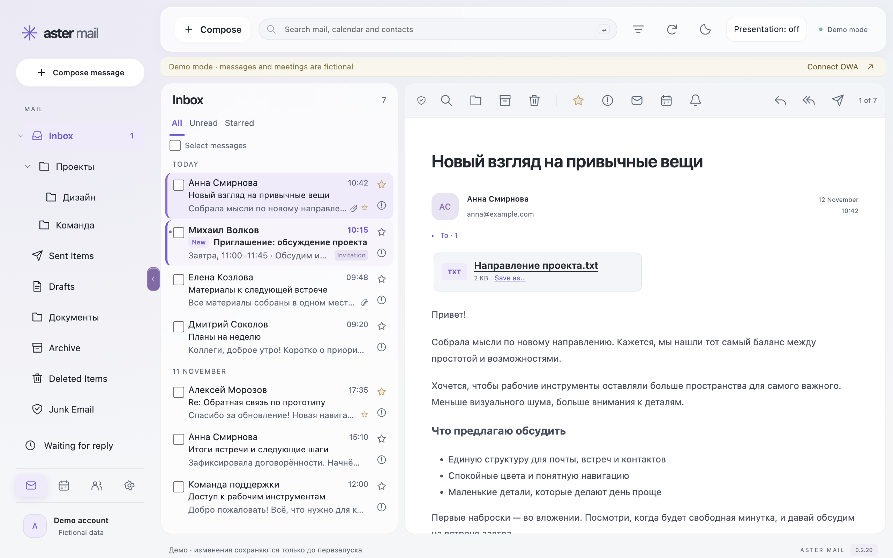

# Aster Mail

A desktop **Microsoft Exchange OWA/EWS** client for **macOS Apple Silicon and
Windows x64**. Mail, calendar and colleagues connect directly to your server,
without an Aster cloud or application telemetry.

**[Download the latest release](https://github.com/darxfame/aster-mail/releases/latest)** ·
[User guide (Russian)](docs/USER-GUIDE.md) · [Русский](README.md)

[](https://github.com/darxfame/aster-mail/releases/latest)
[](https://github.com/darxfame/aster-mail/releases)
[](https://github.com/darxfame/aster-mail/stargazers)
[](https://github.com/darxfame/aster-mail/actions/workflows/release.yml)



## Features

- **Mail:** folders, search, filters, right-click actions, rich text, attachments,
  server drafts and detached editors.
- **Calendar:** invitations, day/week/quarter views, colleague availability and common slots.
- **Workflows:** quick replies, Exchange automatic replies, reply tracking and local mail reminders.
- **macOS widget:** ongoing meetings, countdowns and the day schedule.
- **Interface:** light/dark Air Glass themes, 80–200% scale, Russian/English UI and notification privacy.
- **Modules:** additional capabilities from [Aster Mail Modules](https://github.com/darxfame/aster-mail-modules).
- **MCP:** connect a local agent to mail search/read, folders, moves and rules,
  mail sending/replies/forwards, drafts and attachments, meeting operations,
  contacts, reminders, automatic replies, settings and installed module commands.

## Requirements and installation

| Requirement | Support |
| --- | --- |
| macOS | 13 Ventura or later, Apple Silicon |
| Windows | x64 |
| Server | Exchange with HTTPS OWA access; corporate VPN if required |
| EWS | Required for sending, editing drafts and some other operations |
| Sign-in | OWA forms and same-server NTLM; cross-domain SSO/MFA is not supported yet |

1. Download the **macOS arm64 DMG** or **Windows x64 EXE** from
   [GitHub Releases](https://github.com/darxfame/aster-mail/releases/latest).
2. Move Aster Mail to Applications on macOS, or run the Windows installer.
3. Connect your VPN if needed and enter your HTTPS OWA address.
   A fictional demo is available without an account.

macOS releases use a persistent local signing identity, without Developer ID or
notarization; Windows releases have no publisher certificate yet. Your OS may
show an installation warning. Quit Aster Mail before a manual update.

One account is supported. There is no offline database, shared-mailbox or
PGP/S/MIME support yet. Compatibility depends on your Exchange configuration;
working OWA access does not guarantee every feature.
[Detailed limitations (Russian)](docs/USER-GUIDE.md#ограничения).

## Connect an AI agent through MCP

Aster provides a local **stdio** MCP server for any compatible harness on the
same computer. The agent uses the current Exchange session in Aster and does
not need your Exchange password.

1. Install Node.js 22+ for the MCP process and launch Aster Mail.
2. Open **Settings (gear icon) → MCP · Agents** and select **Enable MCP**.
   This section also provides connection instructions and server status.
3. Select **Copy setup task for agent** and paste the task into your agent chat.
   For manual setup, expand **Manual setup and configuration** and copy its config.
   Sign in to Exchange in Aster.
4. Restart the MCP connection after updating Aster to refresh its tool list.

The MCP settings include dedicated setup and copyable configuration for
**Claude Code / Desktop, Codex, DeepSeek Harness (dsh), Continue and Kilo Code**.
[Harness setup examples (Russian)](docs/MCP.md#настройка-популярных-harness).
Access is disabled by default and must be enabled after each Aster restart.

| Mail | Meetings |
| --- | --- |
| Search by text, sender, recipient, dates and folder; read messages | List, search and read meetings, occurrences and series |
| Create folders and move up to 100 messages per request | Check availability, including your own, and find common free slots |
| Create Exchange rules for future incoming messages from an exact sender | Create meetings with invitations and update existing meetings |

Example requests: “Find mail from anna@example.com about the contract”,
“Move these invoices into a new folder and create a rule for future mail” or
“Find an hour when Anna and I are free tomorrow and create a meeting after
approval.” Availability checks and invitations require exact email addresses.

Mail sends and calendar operations have no Aster confirmation; the agent/harness
handles send authorization. Other writes retain approval in Aster. Moving a meeting's start without supplying
an end preserves its duration; stale meeting versions cannot overwrite newer
ones. Unknown availability is never free. An uncertain write must be checked
in Exchange before another attempt.

Drafts, attachment transfers, meeting RSVP/cancellation, contacts, automatic
replies, reminders, signatures, templates, settings and module commands are
available. Rules can move mail, mark it read, or both. Permanent deletion is
not exposed. Account/service sign-in and module installation use the existing UI. Aster must remain running; remote access from another machine
is not supported. Use a trusted harness: it may send retrieved data to your
chosen AI provider. [Full tool reference and limitations (Russian)](docs/MCP.md).

## Documentation and contributions

- [User guide and workflows (Russian)](docs/USER-GUIDE.md).
- [Security and data (Russian)](SECURITY.md).
- [Development](CONTRIBUTING.en.md) · [macOS signing (Russian)](docs/MACOS-SIGNING.md) · [Windows builds (Russian)](docs/WINDOWS.md).
- [Report an issue](https://github.com/darxfame/aster-mail/issues/new/choose) · [First contributions](https://github.com/darxfame/aster-mail/contribute).

For local development, install Node.js 22+ and npm:

```sh
npm ci
npm start
# Browser demo only:
npm run preview
```

[MIT](LICENSE). Sounds: [CC0](assets/sounds/LICENSE.md).
Adapted-code attribution: [THIRD_PARTY_NOTICES.md](THIRD_PARTY_NOTICES.md).
