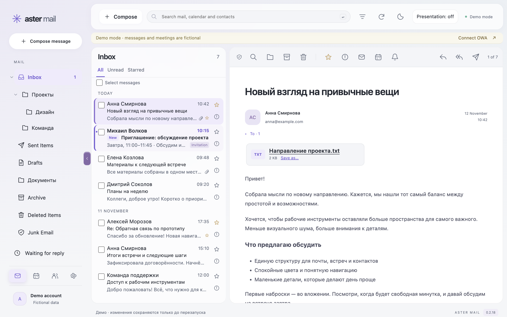

# Aster Mail

A desktop **Microsoft Exchange OWA/EWS** client for **macOS Apple Silicon and
Windows x64**. Mail, calendar and colleagues connect directly to your server,
without an Aster cloud or application telemetry.

**[Download the latest release](https://github.com/darxfame/aster-mail/releases/latest)** ·
[User guide (Russian)](docs/USER-GUIDE.md) · [Русский](README.md)

[](https://github.com/darxfame/aster-mail/releases/latest)
[](https://github.com/darxfame/aster-mail/actions/workflows/release.yml)



## Features

- **Mail:** folders, search, filters, right-click actions, rich text, attachments,
  server drafts and detached editors.
- **Calendar:** invitations, day/week/quarter views, colleague availability and common slots.
- **Workflows:** quick replies, Exchange automatic replies, reply tracking and local mail reminders.
- **macOS widget:** ongoing meetings, countdowns and the day schedule.
- **Interface:** light/dark Air Glass themes, 80–200% scale, Russian/English UI and notification privacy.
- **Modules:** additional capabilities from [Aster Mail Modules](https://github.com/darxfame/aster-mail-modules).

## Requirements and installation

| Requirement | Support |
| --- | --- |
| macOS | 13 Ventura or later, Apple Silicon |
| Windows | x64 |
| Server | Exchange with HTTPS OWA access; corporate VPN if required |
| EWS | Required for sending, editing drafts and some other operations |
| Sign-in | OWA forms and same-server NTLM; cross-domain SSO/MFA is not supported yet |

1. Download the **macOS arm64 DMG** or **Windows x64 EXE** from
   [GitHub Releases](https://github.com/darxfame/aster-mail/releases/latest).
2. Move Aster Mail to Applications on macOS, or run the Windows installer.
3. Connect your VPN if needed and enter your HTTPS OWA address.
   A fictional demo is available without an account.

macOS releases use a persistent local signing identity, without Developer ID or
notarization; Windows releases have no publisher certificate yet. Your OS may
show an installation warning. Quit Aster Mail before a manual update.

One account is supported. There is no offline database, shared-mailbox or
PGP/S/MIME support yet. Compatibility depends on your Exchange configuration;
working OWA access does not guarantee every feature.
[Detailed limitations (Russian)](docs/USER-GUIDE.md#ограничения).

## Documentation and contributions

- [User guide and workflows (Russian)](docs/USER-GUIDE.md).
- [Security and data (Russian)](SECURITY.md).
- [Development](CONTRIBUTING.en.md) · [macOS signing (Russian)](docs/MACOS-SIGNING.md) · [Windows builds (Russian)](docs/WINDOWS.md).
- [Report an issue](https://github.com/darxfame/aster-mail/issues/new/choose) · [First contributions](https://github.com/darxfame/aster-mail/contribute).

For local development, install Node.js 22+ and npm:

```sh
npm ci
npm start
# Browser demo only:
npm run preview
```

[MIT](LICENSE). Sounds: [CC0](assets/sounds/LICENSE.md).
Adapted-code attribution: [THIRD_PARTY_NOTICES.md](THIRD_PARTY_NOTICES.md).
