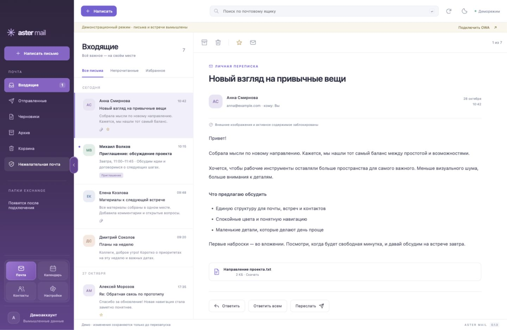
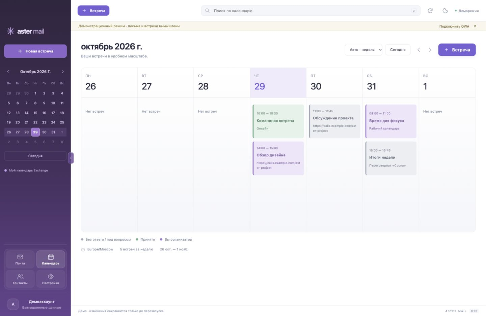
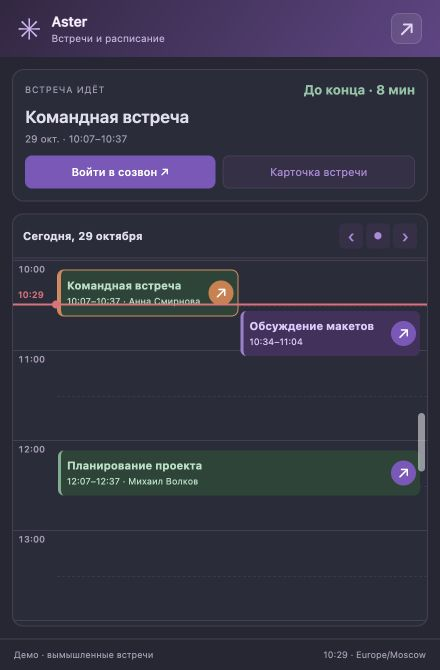

# Aster Mail

**[Download the latest release for macOS / Windows](https://github.com/darxfame/aster-mail/releases/latest)**

**[Читать на русском →](https://github.com/darxfame/aster-mail/blob/main/README.md) · English**

An open-source **Microsoft Exchange OWA/EWS desktop client** for
**macOS Apple Silicon and Windows x64**. Mail, calendar, and colleagues in one
app, connected directly to your server, with no Aster cloud or telemetry.

[](https://github.com/darxfame/aster-mail/releases/latest)
[](https://github.com/darxfame/aster-mail/actions/workflows/checks.yml)
[](LICENSE)

[User guide (Russian)](docs/USER-GUIDE.md) ·
[Roadmap (Russian)](docs/OWA-TODO.md) ·
[Report an issue](https://github.com/darxfame/aster-mail/issues/new/choose) ·
[First contributions](https://github.com/darxfame/aster-mail/contribute)

[](https://raw.githubusercontent.com/darxfame/aster-mail/main/docs/aster-sidebar-cards-0.1.3.jpg)

## Is Aster Mail right for you?

Aster Mail is for people who use corporate Exchange through OWA and want a
dedicated desktop workspace with a calendar and notifications. Compatibility
depends on your server configuration. The app is at an early stage.

| Requirement or limitation | Current support |
| --- | --- |
| Platforms | macOS on Apple Silicon; Windows x64 |
| Connection | An HTTPS OWA URL; your corporate VPN if required |
| EWS access | Required for sending, editing drafts, and some calendar and contact operations |
| Authentication | SSO/MFA through a separate domain is not supported yet |
| Offline use | No offline database yet |
| Interface language | Russian and English; choose Settings → General → Interface language |
| Accounts | One account; no shared mailboxes yet |
| Message encryption | No PGP/S/MIME support yet |

Working OWA access does not guarantee that every feature is available.
Universal Exchange or Microsoft 365 compatibility is not claimed. Verify the
workflows you need on a test Exchange account before using your primary mailbox.
See the [detailed limitations (Russian)](docs/USER-GUIDE.md#ограничения-01).

## What you can do

- **Mail:** folders, search, replies and forwarding, rich-text composition,
  independent compose windows, server drafts, and attachments opened in their system application.
- **Calendar:** day and week views, invitations, colleague availability, and
  suggestions for a common meeting time. On macOS, a menu-bar meeting widget
  shows your next meeting and a countdown.
- **Stay focused:** light and dark themes, configurable notifications, a compact
  connection indicator, and automatic OWA connection recovery. Multiple meeting
  reminders support common intervals and individual schedules, while Aster is
  running and the computer is awake.

Available since [0.1.23](https://github.com/darxfame/aster-mail/releases/tag/v0.1.23):
separate To/Cc fields, recipient cards, and search across mail,
primary-calendar events, and personal contacts.

### Calendar and meetings

[](https://raw.githubusercontent.com/darxfame/aster-mail/main/docs/aster-calendar-0.1.5.jpg)

[](https://raw.githubusercontent.com/darxfame/aster-mail/main/docs/aster-widget-grid-0.1.7.jpg)

## Install

1. Download the **macOS arm64 DMG** or **Windows x64 EXE** from
   [GitHub Releases](https://github.com/darxfame/aster-mail/releases/latest).
2. On macOS, move Aster Mail to Applications. On Windows, run the installer.
3. Connect to your HTTPS OWA address. Connect your corporate VPN first if needed.

Quit Aster Mail completely before updating. Builds are currently unsigned;
your operating system may show installation warnings.

## Data and security

- HTTPS connections with TLS validation; account credentials are sent only to
  your Exchange server.
- Optional password storage through Electron's OS-backed `safeStorage`.
- Mail is cached in memory. Explicitly opened attachments use temporary copies
  with size, count, and lifetime limits.
- Sanitized HTML runs without scripts in a sandbox. Third-party remote images
  are blocked; permitted image requests use no account cookies or password.
- Notification text previews are opt-in. Sends and other writes are not retried
  automatically after an uncertain response.
- Release installers are checked for size and SHA-256 before opening. Downloads retry temporary network failures and resume partial files while the app remains running. Pause keeps the partial file; Cancel download deletes it. A slow download has no overall time limit, but two minutes without new data interrupts it. Servers without range support and downloads after an app restart begin from zero.

No Aster intermediary cloud or application usage telemetry. An independent
security audit is not claimed. See [SECURITY.md (Russian)](SECURITY.md) for
security details and vulnerability reporting.

## Try the demo or develop locally

You need Git, Node.js 22+, and npm:

```sh
git clone https://github.com/darxfame/aster-mail.git
cd aster-mail
npm ci
npm start
```

The desktop app includes a demo with fictional data. To preview the UI in your
browser after installing dependencies:

```sh
npm run preview
```

Open [localhost:4173](http://localhost:4173) and select demo mode. The browser
preview supports demo data only; real Exchange connections require the desktop
app. The demo does not verify compatibility with your server.

## Contribute

Issues and pull requests in **English or Russian** are welcome. Useful
contributions include bug fixes, accessibility improvements, documentation, and
tests using fictional data. Discuss larger changes in an
[issue](https://github.com/darxfame/aster-mail/issues) before implementing them.

Before submitting a PR, run:

```sh
npm run check
npm test
```

Describe the problem, resulting behavior, and verification. Include demo-data
screenshots for UI changes and compatibility notes for protocol changes. Never
test sending or invitations against a real mailbox in automated tests, or post
credentials, cookies, tokens, or corporate messages in issues and screenshots.

Start with [good first issues](https://github.com/darxfame/aster-mail/contribute),
[help wanted](https://github.com/darxfame/aster-mail/issues?q=is%3Aissue%20is%3Aopen%20label%3A%22help%20wanted%22),
or a [compatibility report](https://github.com/darxfame/aster-mail/issues/new?template=compatibility_report.md).

See [CONTRIBUTING.en.md](CONTRIBUTING.en.md),
[Windows builds (Russian)](docs/WINDOWS.md), and
[architecture and repository guidelines](AGENTS.md).

If Aster Mail helps you, star the repository and share it with colleagues who
need an Exchange client.

## License

[MIT](LICENSE). Original notification sounds are
[CC0](assets/sounds/LICENSE.md). Adapted code attribution is recorded in
[THIRD_PARTY_NOTICES.md](THIRD_PARTY_NOTICES.md).

Release asset downloads are not unique or active users. Application usage
statistics are not collected.


### Attachment previews, conflicts and notification privacy

Compose attachment cards preview validated raster images (5 MB / 16 million pixels),
plain text (first 100 KB) and PDF. PDF uses an isolated memory-only session with
outside network requests, navigation and downloads blocked. Other documents open
in the system application on explicit request. New files, server drafts and forwarded
attachments work in both main and detached editors; browser demo previews text only.

Invitations and calendar cards check the account's primary calendar using EWS.
Only a complete result may report a free slot. Tentative conflicts remain separate;
WorkingElsewhere is treated as available. Checks cover a concrete occurrence,
not an entire recurring series, and do not change RSVP. Unlinked invitations,
unknown status, intervals beyond 31 days and incomplete responses remain unknown.
Private conflicting events do not expose their subjects.

Interface scale supports 80–200%, including detached editors and the tray widget.
Navigation defaults to the left. Settings → General → Navigation placement also
offers a bottom bar and saves an explicit choice. Legacy bottom placement resets
to the left. Narrow calendars automatically show one day; week view remains
available manually, and the time grid scrolls within the remaining height.
Reads recover through the existing 15-second background poll after an outage.
Truncated responses and temporary gateway errors do not permanently reject the
account; successful polls refresh connection health. Server writes are never replayed.
Compact tray cards keep Open and Dismiss actions; excess cards expand into a list.
Presentation mode clears existing alerts, tray tooltips and calendar previews without
replaying notifications or sounds on exit. Automatic privacy is enabled by default:
it conservatively hides content while known calling/recording apps or popular browsers
are running, even when they are not sharing. It checks every two seconds and before
alerts, and hides on check failure. This checks running applications, not actual capture;
universal capture detection is not guaranteed. Use manual presentation mode for other
apps. System notification appearance and stacking remain controlled by the OS.

### Modules (development branch)

`codex/modules` adds self-contained browser JavaScript packages with commands,
embedded views, private encrypted state and events. Untrusted code runs inside a
Chromium sandbox with no Node.js, filesystem, Exchange session or direct network
access. The host SDK checks permissions, account identity and destinations.
Install from a package folder or a public GitHub repository under Settings →
Modules. GitHub refs resolve to a pinned commit; only declared files are fetched.
Installation and per-account permission grants require separate confirmations.

[Aster Mail Modules](https://github.com/darxfame/aster-mail-modules) is the
repository for modules from the Aster Mail author. Contribute your own module via
a pull request or discuss an idea in Issues. The in-app approved catalog provides a Connect button that installs and enables
the selected version with its disclosed permissions. Package requirements are in
the guide below.

See [architecture](docs/modules/architecture.md),
[development guide](docs/modules/development.md) and the
[synthetic SDK example](examples/modules/sandbox-demo).
Run `node scripts/check-module.cjs examples/modules/sandbox-demo` and
`npm run test:modules`. These development changes are not merged into main.

[Optional Xerj reference tool](docs/xerj.md): each reference operation requires user consent.
