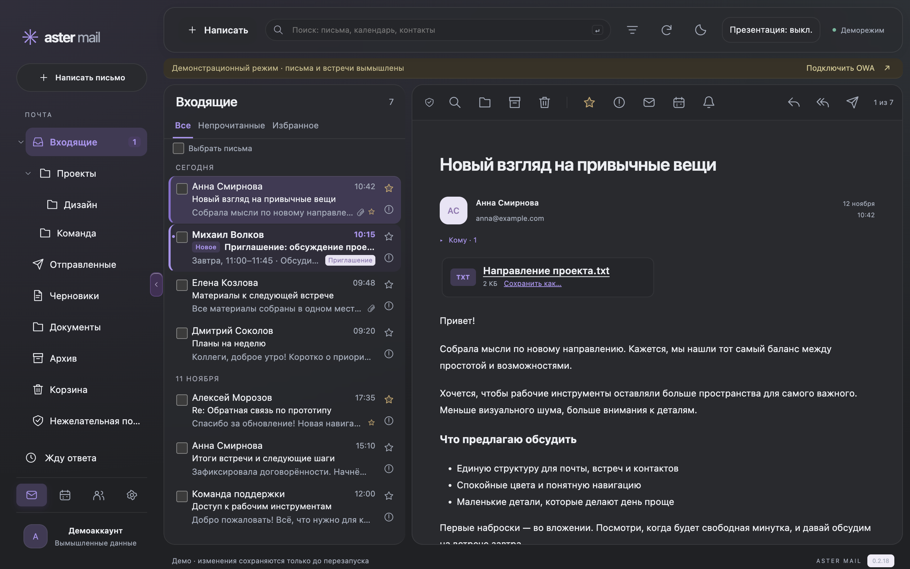

# Aster Mail

Настольный клиент корпоративного **Microsoft Exchange OWA/EWS** для
**macOS Apple Silicon и Windows x64**. Почта, календарь и коллеги в одном
приложении, с прямым подключением к вашему серверу, без облака и телеметрии Aster.

**[Скачать последнюю версию](https://github.com/darxfame/aster-mail/releases/latest)** ·
[Инструкция](docs/USER-GUIDE.md) · [English](README.en.md)

[](https://github.com/darxfame/aster-mail/releases/latest)
[](https://github.com/darxfame/aster-mail/releases)
[](https://github.com/darxfame/aster-mail/stargazers)
[](https://github.com/darxfame/aster-mail/actions/workflows/release.yml)



## Возможности

- **Почта:** папки, поиск, фильтры, быстрые действия по правому клику,
  форматирование, вложения, серверные черновики и отдельные окна редактора.
- **Календарь:** приглашения, день/неделя/квартал, занятость коллег и поиск общего времени.
  Вложения встреч: предпросмотр PDF, изображений и текстовых файлов до 20 МБ;
  остальные документы открываются в системном приложении по нажатию.
- **Рабочие сценарии:** шаблоны ответов, автоответы Exchange, «Жду ответа»
  и локальные напоминания о письмах.
- **Виджет macOS:** текущие встречи, отсчёт времени и расписание дня.
- **Интерфейс:** светлая и тёмная темы Air Glass, масштаб 80–200%,
  русский и английский языки, режим приватности уведомлений.
- **Модули:** дополнительные возможности из каталога
  [Aster Mail Modules](https://github.com/darxfame/aster-mail-modules).

## Совместимость и установка

| Требование | Поддержка |
| --- | --- |
| macOS | 13 Ventura и новее, Apple Silicon |
| Windows | x64 |
| Сервер | Exchange с HTTPS-доступом к OWA; VPN, если требуется компанией |
| EWS | Нужен для отправки, редактирования черновиков и части остальных операций |
| Вход | Формы OWA и NTLM на том же сервере; междоменный SSO/MFA пока не поддерживается |

1. Скачайте **DMG (macOS arm64)** или **EXE (Windows x64)** из
   [GitHub Releases](https://github.com/darxfame/aster-mail/releases/latest).
2. На Mac перенесите приложение в «Программы», на Windows запустите установщик.
3. Подключите VPN при необходимости и укажите HTTPS-адрес OWA.
   Без аккаунта можно выбрать деморежим с вымышленными данными.

Для macOS используется постоянная локальная подпись, без Developer ID и
нотариализации; Windows-сборки пока без сертификата издателя. ОС может показать
предупреждение при установке. Перед ручным обновлением полностью завершите Aster Mail.

Пока поддерживается один аккаунт, без офлайн-базы, общих ящиков и PGP/S/MIME.
Совместимость зависит от конфигурации Exchange; доступность OWA не гарантирует
работу всех функций. [Подробнее об ограничениях](docs/USER-GUIDE.md#ограничения).

## Документация и участие

- [Инструкция и рабочие сценарии](docs/USER-GUIDE.md) — настройка, почта, встречи, напоминания и обновления.
- [Безопасность и данные](SECURITY.md) — хранение, изоляция содержимого и сообщения об уязвимостях.
- [Разработка](CONTRIBUTING.md) · [Подпись macOS](docs/MACOS-SIGNING.md) · [Сборка Windows](docs/WINDOWS.md).
- [Сообщить об ошибке](https://github.com/darxfame/aster-mail/issues/new/choose) · [Задачи для первого PR](https://github.com/darxfame/aster-mail/contribute).

Для запуска из исходников нужны Node.js 22+ и npm:

```sh
npm ci
npm start
# Только демо в браузере:
npm run preview
```

[MIT](LICENSE). Звуки — [CC0](assets/sounds/LICENSE.md),
атрибуция адаптированного кода — [THIRD_PARTY_NOTICES.md](THIRD_PARTY_NOTICES.md).
