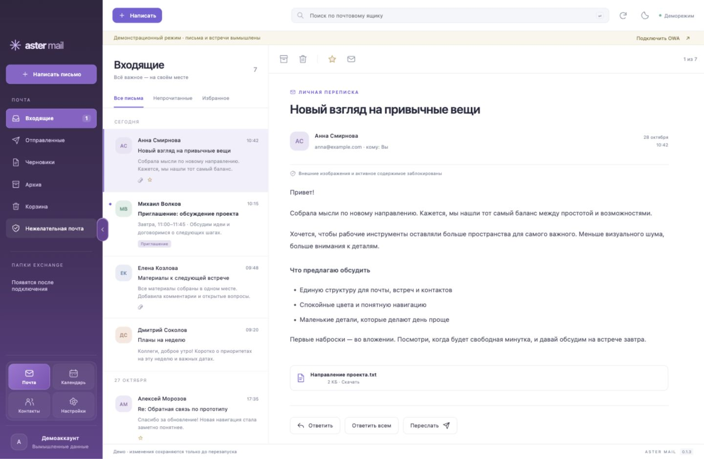
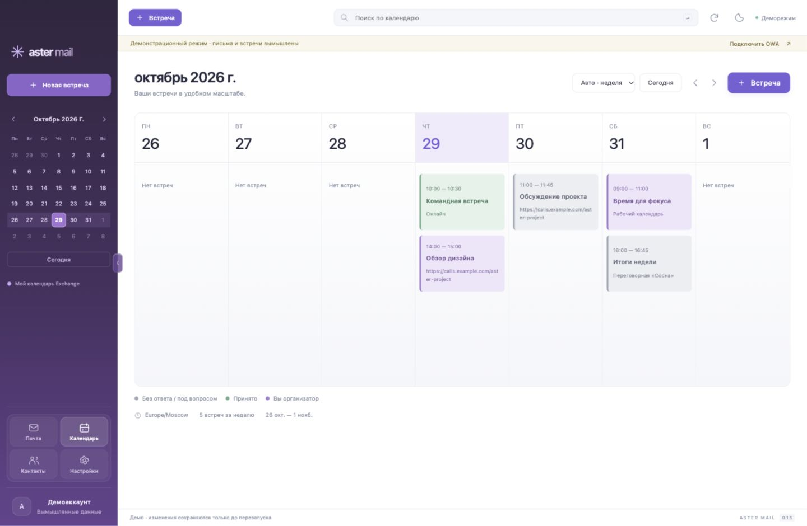

# Aster Mail

[](https://github.com/darxfame/aster-mail/actions/workflows/checks.yml)
[](LICENSE)

**Ранняя open-source версия · macOS Apple Silicon · Windows готовится к проверке**

Настольный клиент для корпоративного Exchange: почта, календарь и контакты.
Первая платформа — **macOS Apple Silicon**, основа на Electron рассчитана и на
Windows. Интерфейс на русском, светлая и тёмная темы, навигация в духе Mustang
и Outlook. Лицензия MIT.



Карточки почты, календаря, контактов и настроек расположены слева под папками,
над аккаунтом. В настройках их можно перенести вниз окна. Фиолетовая панель
папок сворачивается до иконок стрелкой на границе или перетаскиванием; выбор
запоминается. При первом запуске меню раскрыто. При увеличении масштаба письмо открывается отдельно от списка.
Календарь поддерживает день, неделю и квартал: в режиме «Авто» узкое окно
показывает один день. Из квартала можно открыть выбранную дату.

В строке меню macOS отображается время до ближайшей встречи. Нажатие открывает
виджет с ближайшими событиями, кнопками входа в созвон и открытия карточки в Aster.
Ссылки HTTPS распознаются в поле подключения, месте и описании встречи; кнопка
входа недоступна, если ссылка не найдена. Проверка Exchange выполняется раз в минуту,
отсчёт обновляется каждые 15 секунд. Правый клик по значку открывает служебное меню.

Это самостоятельная первая реализация, **не полный форк Mustang**.
Проприетарные модули Mustang не используются. Подключение адаптирует MIT-код
mac-owa-widget; атрибуция в [THIRD_PARTY_NOTICES.md](THIRD_PARTY_NOTICES.md).

## Календарь и карточка встречи

В боковом меню календаря есть календарик месяца: стрелки меняют месяц, нажатие
даты переводит основной календарь к выбранному дню или неделе. В почте папки
Exchange встроены в единое дерево: основные папки сопоставляются по ID, подпапки
раскрываются рядом с родительскими. При первом запуске меню раскрыто.

Цвет встречи отражает статус: серый — приглашение без ответа или «под вопросом»,
зелёный — принято, фиолетовый — вы организатор. Отменённые встречи зачёркнуты.

Нажатие встречи открывает карточку с HTML-описанием, организатором, участниками
и их ответами. Можно ответить организатору или всем, принять/отклонить приглашение,
переслать его либо добавить участников своей встречи. Для повторяющихся встреч
есть выбор «Этот повтор» / «Весь ряд». Изменение ряда сохраняет правило повторения;
редактор нового правила повторения пока отсутствует.

Организатор редактирует название, время, место, описание и участников; приглашённый
участник — личное напоминание, занятость и конфиденциальность своей копии.
Изменения расписания и участников рассылаются Exchange. Неизменённые HTML-описание,
ресурсы, необязательные участники и вложения сохраняются. Изменённое описание
записывается обычным текстом. Если серверная версия встречи изменилась, сохранение
останавливается: карточку нужно открыть заново. Операции отправки не повторяются.

Изображения PNG/JPEG/GIF/WebP из вложений показываются автоматически (до шести,
каждое до 5 МБ); остальные файлы можно скачать. Внешние изображения не загружаются.
Рядом со ссылкой на конференцию есть вход в звонок. Нажатие вне карточки закрывает
просмотр; форма редактирования таким нажатием не закрывается.

Детальная карточка и редактирование требуют EWS. Действия ограничены правами
Exchange, включая запрет пересылки организатором. Личное серверное напоминание
приоритетнее общего времени напоминания Aster; общий выключатель уведомлений
по-прежнему действует.



## Скачать установщик

Готовые **DMG для macOS Apple Silicon** и **EXE для Windows x64** публикуются
в [GitHub Releases](https://github.com/darxfame/aster-mail/releases).
Публикация запускается тегом `v<версия>` и происходит после успешной сборки обоих
установщиков и автотестов. Тег должен совпадать с версией в `package.json`.
Сборки предварительные: macOS без Developer ID/notarization, Windows без подписи
издателя. Установка обновлений пока ручная; перед обновлением завершите Aster.

## Коллеги и планирование

В контактах блок «Коллеги» хранит до 50 избранных людей отдельно для каждого
аккаунта. Кнопка «+» открывает поиск по общему каталогу Exchange. Контакт также
можно закрепить из его карточки. Список хранится локально; кнопка удаления убирает
человека только из избранного.

Занятость запрашивается через OWA `GetUserAvailabilityInternal`, по тому же принципу,
что в mac-owa-widget. Статус календаря показывает свободное время, занятость,
предварительные встречи и отсутствие на месте. Это не присутствие в Teams/Skype.
Проверка раз в минуту при открытом разделе контактов, горизонт — три дня,
точность — 15 минут. При отсутствии доступа, неполном ответе или ошибке показывается
«Нет данных». «Проверено до» обозначает границу загруженного периода.

В форме новой встречи помощник планирования проверяет полную длительность встречи
для участников и организатора. Избранных коллег можно добавить флажками. Помощник
предлагает до шести общих интервалов с 09:00 до 18:00 выбранного дня, с шагом
15 минут. Нажатие интервала меняет время в форме; приглашение отправляется только
кнопкой создания встречи. Занятость может измениться после проверки. Для логина
`DOMAIN\user` собственная занятость определяется из личного календаря OWA.
Совместимость запроса и права доступа нужно проверить на конкретном сервере.

## Запуск

Нужен Node.js 22 или новее и npm.

```sh
npm ci
npm start
```

Нажмите **Подключить OWA**, введите HTTPS-адрес вида
`https://mail.company.ru/owa/`, логин и пароль — те же, что в mac-owa-widget.
Если нужен корпоративный VPN, подключите его заранее. Пароли и токены не нужно
добавлять в исходники или присылать в чат.

**Посмотреть демо** открывает вымышленные данные без отправки писем и приглашений.
Браузерный предпросмотр без OWA: `npm run preview`, затем
`http://127.0.0.1:4173/src/index.html`.

## Возможности

- Формы OWA и NTLM на том же HTTPS-сервере.
- Папки, постраничная загрузка писем, HTML и текст, серверный поиск по ящику.
- Ответ, ответ всем, пересылка, создание черновика, отправка и скачивание вложений.
- Подпись, прочтение, избранное, перемещение в архив и корзину.
- Загрузка серверной подписи OWA с сохранением HTML-оформления при отправке.
- Календарь: день, неделя и квартал, создание встреч, приглашения и RSVP.
- Помощник планирования, общая занятость и избранные коллеги Exchange.
- Личные контакты, добавление контактов, поиск людей в каталоге Exchange.
- Системные уведомления новых писем и напоминания встреч с двумя оригинальными
  звуками CC0. Проверка раз в минуту, работа при скрытом окне через строку меню.

Ответ на встречу отправляется одним нажатием без дополнительного подтверждения.
У отменённых встреч кнопки ответа скрыты. Если отмена пришла во время отправки,
клиент показывает отменённое состояние и не повторяет ответ.

Чтение использует `/owa/service.svc`; отправка, создание контактов/встреч и RSVP —
`/EWS/Exchange.asmx`, как в mac-owa-widget. Работающий календарь в виджете не
гарантирует доступность всех почтовых операций EWS. Совместимость зависит от версии и настроек Exchange; универсальная
совместимость со всеми серверами не заявляется.

## Хранение и безопасность

В настройках включите **Использовать подпись из OWA**. Aster читает
`OWA.UserOptions` через EWS `GetUserConfiguration` и обновляет подпись при
создании письма. Учитываются серверные настройки автоматической подписи для новых
писем и ответов. HTML очищается перед использованием, оформление сохраняется при
отправке. В редакторе показывается текст подписи; изображения и таблицы появятся
в отправленном HTML-письме. Если отредактировать текст самой подписи в редакторе,
сообщение отправится с этой текстовой версией. При отключении галочки доступна
прежняя локальная подпись. Настройки OWA на сервере не изменяются.

Доступность подписи зависит от настроек Exchange; при недоступности
`OWA.UserOptions` клиент покажет ошибку и предложит локальную подпись.

Прямое подключение к Exchange без облака Aster и телеметрии. Сессионные cookies
находятся в памяти. При выборе «Запомнить» пароль хранится в зашифрованном
`account.enc` в каталоге данных приложения; ключ защищает Electron `safeStorage`
(Keychain на macOS). Выход удаляет сохранённые данные входа и сессию.
Подпись и тема сохраняются локально отдельно от пароля.

HTML очищается DOMPurify и отображается в изолированном sandbox-iframe.
Внешние изображения заблокированы. Обычные ссылки открываются после подтверждения в
системном браузере; явная кнопка входа в звонок открывает HTTPS-ссылку сразу. Проверка TLS включена; авторизация на другом сервере
блокируется. Отправка при обрыве связи автоматически не повторяется — проверьте
«Отправленные» и «Черновики» перед повтором.

## Проверка и сборка

```sh
npm run check       # синтаксис
npm test            # протокол и операции с тестовым транспортом
npm run pack:mac    # .app в release/mac-arm64/
npm run dist:mac    # DMG для macOS arm64
npm run dist:win -- --x64 --publish never # NSIS для Windows, пока не проверен
```

Локальная сборка не является подписанным и нотарифицированным публичным релизом.
Для распространения нужны Developer ID, notarization и проверка на чистом Mac.
Windows можно собирать вручную через GitHub Actions; инструкции и ограничения —
[docs/WINDOWS.md](docs/WINDOWS.md). Теги `v<версия>` запускают автоматическую публикацию DMG и EXE через
[Publish installers](.github/workflows/release.yml).

## Ограничения 0.1

Один аккаунт. Пока нет общих ящиков, офлайн-базы,
создания правил повторения, редактирования/удаления контактов, удаления событий, редактирования
существующего черновика. Сохранение создаёт новый серверный черновик.
Нет встроенных изображений, PGP/S/MIME и SSO/MFA через отдельный домен.
Вложения: до 20 МБ на исходящее письмо, до 30 МБ на входящий ответ.
Серверный поиск ограничен 250 результатами; фильтры прочтения и избранного
действуют на загруженные письма.

Автотесты используют вымышленные ответы и не подтверждают совместимость с живым
Exchange. Проверяйте чтение, отправку, вложения и приглашения на тестовом аккаунте
перед использованием для основной почты.

## Уведомления и открытые звуки

В **Настройки → Уведомления и звуки** можно отдельно включить баннеры почты,
встречи, звук и показ содержимого, выбрать напоминание за 0/5/10/15/30 минут,
проверить оба системных уведомления. Разрешите баннеры и звуки Aster Mail в
системных настройках macOS; Focus/«Не беспокоить» и системная громкость влияют
на доставку и воспроизведение.

При подключённом аккаунте закрытие окна оставляет приложение в строке меню.
Полный выход завершает проверки; во время сна и без сети новые данные не
загружаются. Первая загрузка почты создаёт молчаливую исходную точку; оповещения
приходят о последующих непрочитанных письмах. Один раз за сеанс напоминаем о каждой
встрече с данным временем начала; отменённые, отклонённые и события на весь день
пропускаются. После перезапуска близкая встреча может напомнить о себе снова.

Звуки `assets/sounds/aster-mail.wav` и `aster-meeting.wav` созданы процедурно без
сторонних семплов и опубликованы под **CC0-1.0**. Исходник:
`scripts/sounds.cjs`, регенерация: `node scripts/sounds.cjs`.
Лицензия: `assets/sounds/LICENSE.md`. Упаковщик помещает WAV в ресурсы macOS-бандла.
На macOS звуки воспроизводит сам Aster через `afplay`; системный баннер остаётся
без второго звука. Используются переключатель звука Aster и обычная громкость
аудиовыхода. В Windows звук воспроизводит интерфейс; Windows пока не проверена.

## Структура

`desktop/` — Electron, IPC, OWA/EWS; `src/` — интерфейс и демоданные;
`test/` — тесты Node.js; `assets/` — оригинальный логотип;
`scripts/` — предпросмотр и генерация иконки (`node scripts/icon.cjs`).

## Участие и поддержка

Правила разработки — [CONTRIBUTING.md](CONTRIBUTING.md), инструкции для агентов —
[AGENTS.md](AGENTS.md), сообщения об уязвимостях — [SECURITY.md](SECURITY.md).
Ошибки и предложения: [GitHub Issues](https://github.com/darxfame/aster-mail/issues).
Проверки исходников выполняются в GitHub Actions на macOS и Windows.

Лицензия кода — [MIT](LICENSE), звуков — [CC0](assets/sounds/LICENSE.md).
Атрибуция сторонних проектов — [THIRD_PARTY_NOTICES.md](THIRD_PARTY_NOTICES.md).
