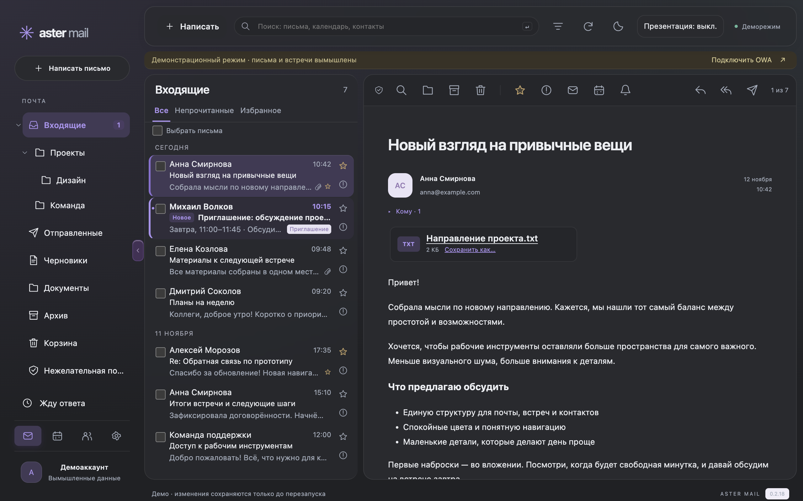

# Aster Mail

Настольный клиент корпоративного **Microsoft Exchange OWA/EWS** для
**macOS Apple Silicon и Windows x64**. Почта, календарь и коллеги в одном
приложении, с прямым подключением к вашему серверу, без облака и телеметрии Aster.

**[Скачать последнюю версию](https://github.com/darxfame/aster-mail/releases/latest)** ·
[Инструкция](docs/USER-GUIDE.md) · [English](README.en.md)

[](https://github.com/darxfame/aster-mail/releases/latest)
[](https://github.com/darxfame/aster-mail/releases)
[](https://github.com/darxfame/aster-mail/stargazers)
[](https://github.com/darxfame/aster-mail/actions/workflows/release.yml)



## Возможности

- **Почта:** папки, поиск, фильтры, быстрые действия по правому клику,
  форматирование, вложения, серверные черновики и отдельные окна редактора.
  Очистка корзины удаляет письма и подпапки через EWS. Восстановление зависит от настроек Exchange.
- **Коллеги:** закреплённых коллег можно вручную распределять по командам.
  Команды хранятся в локальном зашифрованном профиле аккаунта.
- **Календарь:** приглашения, день/неделя/квартал, занятость коллег и поиск общего времени.
  Вложения встреч: предпросмотр PDF, изображений и текстовых файлов до 20 МБ;
  остальные документы открываются в системном приложении по нажатию.
- **Ваш день:** вместо пустого экрана чтения — счётчик непрочитанных во входящих,
  до пяти превью писем, ближайшие встречи на семь дней и занятость в настроенные
  рабочие часы. Цветная шкала и окна без встреч рассчитываются по интервалам
  календаря; пересечения считаются один раз. Цвета совпадают с легендой календаря,
  неподтверждённые встречи отмечены штриховкой и учитываются в занятости.
  Отменённые встречи скрыты, отклонённые видны, но не блокируют свободные окна.
  Сверху показано ближайшее окно, под шкалой — самое длинное оставшееся.
  При работающем соединении расписание обновляется через 15-секундный опрос.
  Без ИИ и сохранения содержимого на диск.
- **Рабочие сценарии:** шаблоны ответов, автоответы Exchange, «Жду ответа»
  и локальные напоминания о письмах.
- **Виджет macOS:** текущие встречи, отсчёт времени и расписание дня.
- **Интерфейс:** светлая и тёмная темы Air Glass, масштаб 80–200%,
  русский и английский языки, режим приватности уведомлений.
- **Модули:** дополнительные возможности из каталога
  [Aster Mail Modules](https://github.com/darxfame/aster-mail-modules).
- **MCP:** локальный доступ агента к почте, папкам, переносу и правилам,
  поиску встреч, занятости и подбору времени, созданию и изменению встреч;
  включается явно; отправка писем и операции со встречами подтверждаются на стороне агента/harness.
  [Подключение и ограничения](docs/MCP.md).

## Совместимость и установка

| Требование | Поддержка |
| --- | --- |
| macOS | 13 Ventura и новее, Apple Silicon |
| Windows | x64 |
| Сервер | Exchange с HTTPS-доступом к OWA; VPN, если требуется компанией |
| EWS | Нужен для отправки, редактирования черновиков и части остальных операций |
| Вход | Формы OWA и NTLM на том же сервере; междоменный SSO/MFA пока не поддерживается |

1. Скачайте **DMG (macOS arm64)** или **EXE (Windows x64)** из
   [GitHub Releases](https://github.com/darxfame/aster-mail/releases/latest).
2. На Mac перенесите приложение в «Программы», на Windows запустите установщик.
3. Подключите VPN при необходимости и укажите HTTPS-адрес OWA.
   Без аккаунта можно выбрать деморежим с вымышленными данными.

Для macOS используется постоянная локальная подпись, без Developer ID и
нотариализации; Windows-сборки пока без сертификата издателя. ОС может показать
предупреждение при установке. Перед ручным обновлением полностью завершите Aster Mail.

Пока поддерживается один аккаунт, без офлайн-базы, общих ящиков и PGP/S/MIME.
Совместимость зависит от конфигурации Exchange; доступность OWA не гарантирует
работу всех функций. [Подробнее об ограничениях](docs/USER-GUIDE.md#ограничения).

## Подключение ИИ-агента через MCP

Aster предоставляет локальный MCP-сервер для любого harness с поддержкой
**stdio** на том же компьютере. Подключённый агент использует текущую сессию
Exchange; отдельно вводить пароль в агенте не нужно.

1. Установите Node.js 22+ для запуска MCP-сервера и откройте Aster Mail.
2. Откройте **Настройки (шестерёнка) → MCP · Агенты** и нажмите **Включить MCP**.
   Здесь же доступны инструкция подключения и статус сервера. Выберите Claude Code / Desktop,
   Codex, DeepSeek Harness (dsh), Continue или Kilo Code — формат конфигурации
   и инструкция переключатся вместе.
3. Нажмите **Скопировать инструкцию для агента** и вставьте готовую задачу
   в чат выбранного harness. Для ручной настройки раскройте конфигурацию.
   Подключитесь к Exchange в Aster.
4. После обновления Aster перезапустите MCP-подключение, чтобы обновился
   список инструментов. Выбранное состояние MCP сохраняется после перезапуска и обновления Aster.

| Почта | Встречи |
| --- | --- |
| Поиск в текущей папке с сохранением фильтров; выбор другой папки или всего ящика; поиск по тексту, отправителю, получателю и датам; чтение писем | Список, поиск и детали встреч, отдельных повторов и рядов |
| Создание папок, перенос до 100 писем за запрос | Проверка занятости с учётом текущего пользователя и подбор общего времени |
| Правила Exchange для будущих входящих от заданного отправителя | Создание встреч с приглашениями и изменение существующих встреч |

Например: «Найди письма от anna@example.com про договор», «Создай папку
“Счета”, перемести туда эти письма и добавь правило для новых» или «Подбери
на завтра час, свободный у меня и Анны, и создай встречу после подтверждения».
Для проверки занятости и приглашения нужны точные email участников.

Отправка, ответы, пересылка и операции со встречами работают без окон
подтверждения в Aster; разрешение на отправку запрашивает агент/harness.
Создание папок и правил, перенос писем и остальные изменения сохраняют
подтверждение в клиенте. При переносе начала встречи без нового окончания
длительность сохраняется; старую версию встречи нельзя перезаписать.
Неизвестная занятость не считается свободной. После неопределённого результата
записи агент должен проверить Exchange перед новой попыткой.

Также доступны серверные черновики, вложения через память, ответы на
приглашения и отмена встреч, контакты, автоответы, напоминания, подписи, шаблоны,
настройки и команды установленных модулей. Правило может переместить письмо,
отметить его прочитанным или выполнить оба действия. Постоянного удаления нет. Aster должен оставаться запущенным;
удалённое подключение с другого компьютера не поддерживается. Подключайте
доверенный harness: прочитанные данные могут передаваться выбранному поставщику
ИИ. [Все инструменты, параметры и ограничения](docs/MCP.md).

## Документация и участие

- [Инструкция и рабочие сценарии](docs/USER-GUIDE.md) — настройка, почта, встречи, напоминания и обновления.
- [Безопасность и данные](SECURITY.md) — хранение, изоляция содержимого и сообщения об уязвимостях.
- [Разработка](CONTRIBUTING.md) · [Подпись macOS](docs/MACOS-SIGNING.md) · [Сборка Windows](docs/WINDOWS.md).
- [Сообщить об ошибке](https://github.com/darxfame/aster-mail/issues/new/choose) · [Задачи для первого PR](https://github.com/darxfame/aster-mail/contribute).

Для запуска из исходников нужны Node.js 22+ и npm:

```sh
npm ci
npm start
# Только демо в браузере:
npm run preview
```

[MIT](LICENSE). Звуки — [CC0](assets/sounds/LICENSE.md),
атрибуция адаптированного кода — [THIRD_PARTY_NOTICES.md](THIRD_PARTY_NOTICES.md).

Правила входящей почты доступны в **Настройки → Правила**: создание, просмотр,
изменение условий и действий, приоритета, включение/выключение и удаление.
Условия, действия и исключения добавляются отдельными строками. Можно задать
отправителей из справочника, фразы по теме и тексту, фильтры по вложениям и
получателю, перенос или копирование в папку, отметку прочтения, важность и
остановку обработки. Правила
с другими условиями или действиями доступны только для просмотра. Внутренние
отправители Exchange отображаются по имени и сохраняют исходный адрес EX;
при наличии блока правил Outlook изменения заблокированы, используйте OWA/Outlook.

В **Настройки → Общие** можно включить беседы, задержку перед отправкой и выбрать
блоки для экрана «Ваш день». Беседы группируют загруженные письма по идентификатору
Exchange в текущем списке. Из письма можно открыть переписку во всех доступных
папках (до 200 результатов Exchange, без черновиков). В течение выбранной задержки письмо остаётся в редакторе
и его можно вернуть к редактированию.
