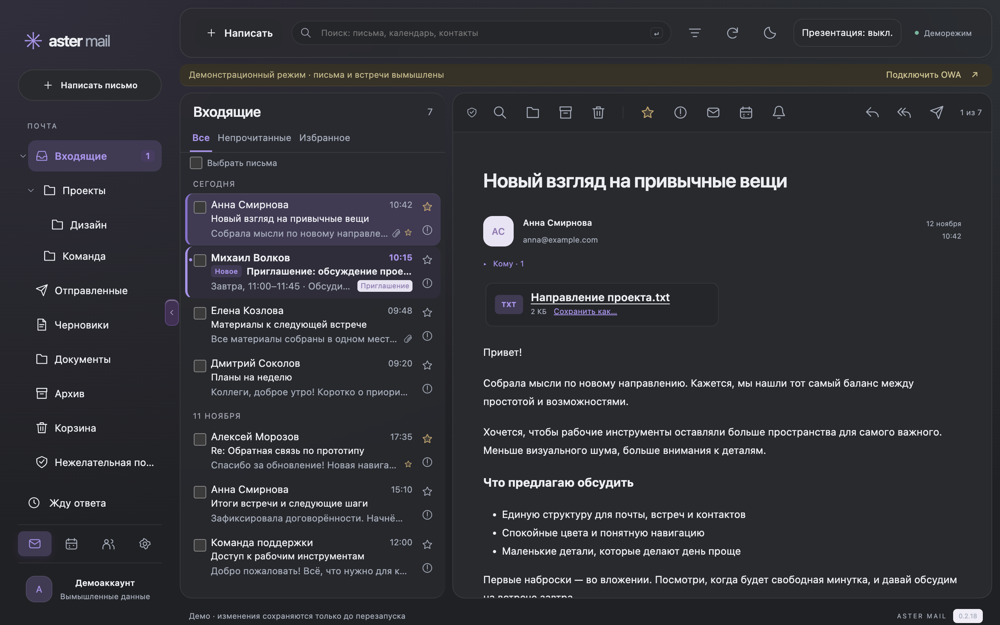
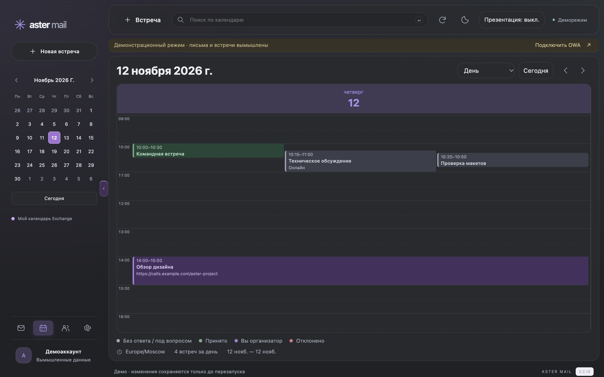
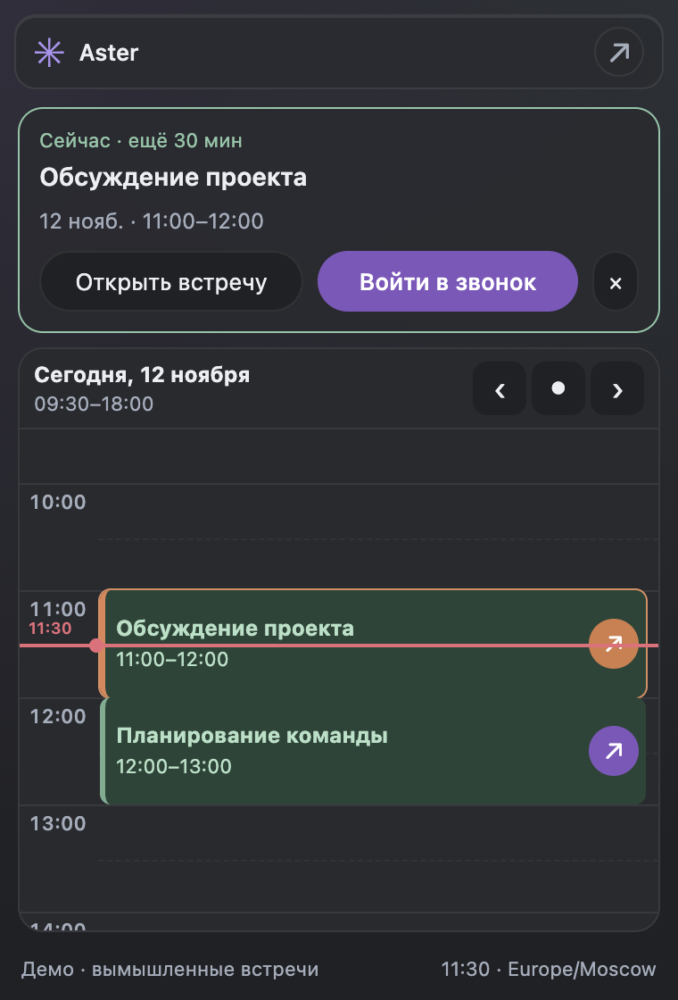

# Руководство Aster Mail

[← О проекте](../README.md) · [Скачать](https://github.com/darxfame/aster-mail/releases/latest)

- [Подключение и настройки](#подключение-и-настройки)
- [Почта и быстрые действия](#почта-и-быстрые-действия)
- [Написать, ответить и сохранить черновик](#написать-ответить-и-сохранить-черновик)
- [Вернуться к письму и дождаться ответа](#вернуться-к-письму-и-дождаться-ответа)
- [Календарь и встречи](#календарь-и-встречи)
- [Виджет macOS](#виджет-macos)
- [Коллеги и поиск](#коллеги-и-поиск)
- [Модули](#модули)
- [Уведомления и приватность](#уведомления-и-приватность)
- [Обновления и данные](#обновления-и-данные)
- [Ограничения](#ограничения)

Все скриншоты используют вымышленные письма и участников.

## Подключение и настройки

1. Установите DMG для macOS Apple Silicon или EXE для Windows x64 из
   [GitHub Releases](https://github.com/darxfame/aster-mail/releases/latest).
2. Включите корпоративный VPN, если он требуется для доступа к почте.
3. Укажите HTTPS-адрес OWA, логин и пароль. Поддерживаются формы OWA
   и NTLM на том же сервере. Сертификат сервера должен быть доверен ОС.
4. Выберите «Запомнить пароль», если нужен автоматический вход после запуска.
   Без этой галочки после полного завершения приложения пароль вводится заново.

«Посмотреть демо» открывает приложение с вымышленными данными, без Exchange.
Демо показывает интерфейс, но не подтверждает совместимость с вашим сервером.

В **Настройки → Общие** доступны язык, тема, часовой пояс, масштаб 80–200%,
расположение навигации и рабочие дни/часы. Рабочее время влияет на календарь
и виджет, но не меняет настройки Exchange.

Панель папок сворачивается стрелкой на границе или перетаскиванием границы.
На узком окне она автоматически становится компактной. При небольшом пространстве
список писем и читатель показываются по очереди; кнопка «К письмам» возвращает список.

## Почта и быстрые действия

- Выберите папку, затем письмо. Открытие обычного письма помечает его прочитанным.
- Фильтры «Все», «Непрочитанные», «Избранное» работают в текущем списке.
- Прочитанные письма имеют обычное начертание. Новые выделены полужирным текстом
  и мягким фоном; выбранное письмо выделяется сильнее.
- **Правый клик** по строке открывает меню: открыть, пометить прочитанным или
  непрочитанным, в архив, в корзину. С клавиатуры — Shift+F10; Escape закрывает меню.
  Действие относится к этой строке, а не ко всем письмам с галочками.
- Для массового действия отметьте письма галочками. Можно выбрать до 100 загруженных
  писем; это не означает весь почтовый ящик. Корзина не является безвозвратным удалением.
- Кнопки звезды и важности находятся прямо в строке. Письмо можно перетащить в папку
  или переместить кнопкой над открытым письмом.

После переноса можно создать серверное правило для следующих писем от отправителя.
Старые письма автоматически не обрабатываются, существующие правила Outlook сохраняются.
Правый клик по папке позволяет создать подпапку, переименовать обычную папку,
переместить её в корзину или отметить всю папку прочитанной.
Системные папки, включая ошибки синхронизации Outlook, защищены от переименования
и удаления. Пользовательские имена папок не переводятся.

### Картинки и содержимое письма

HTML очищается и показывается без скриптов, форм и активного содержимого.
Явно заданные фоны сохраняются. Без заданного фона письмо следует теме приложения;
пустое тело не создаёт большой белый блок. Табличная ширина из HTML сохраняется,
а письмо ограничивается доступной областью просмотра.

Встроенные CID/data-картинки и обычные HTTP/HTTPS-картинки загружаются через
отдельную сессию без cookies и пароля Exchange. Корпоративные короткие имена
серверов поддерживаются; для них может понадобиться VPN. HTTP-картинки передаются
без шифрования. Посторонние буквальные локальные IP и localhost не разрешены.
Известные collect-пиксели Google Analytics пропускаются и не создают заглушки.
Это не универсальная защита от отслеживания внешними картинками.

Подсказка **«Изображение недоступно»** показывает причину и адрес. Ошибка HTTP 401/403
означает, что сервер требует отдельного доступа; пароль Exchange ему не передаётся.
Ошибка сертификата не обходится. Поддерживается проверенный растровый формат
PNG/JPEG и статические GIF/WebP, до 5 МБ на картинку, с ограничением размеров
и общего объёма. SVG, анимация и картинки из CSS-фонов не поддерживаются.

Не публикуйте адрес картинки с токенами или личными данными в открытом issue.

### Вложения

Нажмите имя вложения для предпросмотра. Изображения и текст открываются внутри
читателя, PDF — в отдельном изолированном просмотре. «К письму» или Escape
возвращают прежнее место чтения. Другие документы можно явно открыть
в системном приложении; для этого создаётся временная копия.
«Сохранить как…» сохраняет выбранный файл в указанное вами место.

Для текста показываются первые 100 КБ. Предпросмотр картинки ограничен 5 МБ
и 16 млн пикселей. Активные типы файлов не запускаются. При недоступном
предпросмотре сохраните файл явно и проверьте его обычными средствами компании.

## Написать, ответить и сохранить черновик

1. Нажмите «Написать» или выберите ответ/ответ всем/пересылку над письмом.
2. Заполните «Кому», при необходимости «Копия» и «Скрытая копия».
   Подсказки ищут имя или email в корпоративном каталоге. Скрытая копия
   не переносится в «Ответить всем».
3. Добавьте текст, форматирование и вложения. Общий размер новых вложений — до 20 МБ.
4. Нажмите «Отправить» либо сохраните серверный черновик.

Редактор поддерживает шрифт, размер, цвет, списки, выравнивание и ссылки.
Вставленный HTML очищается. Подпись OWA настраивается в разделе подписи;
картинки серверной подписи перед отправкой должны быть успешно загружены.
«Быстрые ответы» вставляют выбранный текст в позицию курсора без замены адресатов,
подписи и вложений. До 30 шаблонов хранятся зашифрованно для текущего аккаунта,
без синхронизации между устройствами.

Редактор можно вынести в отдельное окно и продолжать работать с другим письмом.
Незавершённая форма сохраняется при ошибке отправки. Важные письма сохраняйте
в серверные черновики: восстановления после аварийного завершения пока нет.

«Продолжить черновик» открывает сохранённое письмо из папки «Черновики».
Изменённый в OWA черновик нужно открыть заново, чтобы не затереть чужую редакцию.
Удаление уже сохранённых вложений и специальные/зашифрованные черновики
могут потребовать OWA.

**При неизвестном результате записи сначала проверьте OWA.** Aster не повторяет
отправку, перенос или приглашение автоматически, чтобы не создавать дубликаты.

### Автоответы

В **Настройки → Автоответы** загрузите текущие параметры Exchange, задайте
период или постоянный режим и тексты для сотрудников/внешних отправителей.
Сохраняйте отдельной кнопкой этого раздела. Ответы отправляет Exchange даже
при закрытом Aster; доступная внешняя аудитория определяется политикой компании.
После ошибки перечитайте настройки перед повтором. Одновременное редактирование
в OWA и Aster может привести к конфликту.

## Вернуться к письму и дождаться ответа

### Оставить непрочитанным

Кнопка конверта в читателе помечает письмо непрочитанным и возвращает к списку.
Меню ПКМ делает ту же пометку без открытия письма. Это не назначает время напоминания
и не меняет папку.

### Напомнить позже

1. Нажмите колокольчик в открытом письме и задайте срок.
2. При желании включите немедленную пометку непрочитанным и возврат к списку.
3. Просмотрите или удалите запись через **«Напоминания о письмах»** в меню папок.

До 30 напоминаний сохраняются локально для аккаунта. Они срабатывают, пока Aster
запущен и аккаунт подключён; пропущенные во сне сроки объединяются после
возобновления работы. Выход из аккаунта удаляет локальные напоминания.
В демо системных уведомлений нет. Серверные письма не перемещаются таймером.

### Жду ответа

В отправленном письме нажмите часы и задайте срок ожидания. Список **«Жду ответа»**
показывает просрочки и обнаруженные ответы; найденные ответы исключаются из счётчика.
«Напомнить об ответе» готовит обычный ответ всем с редактируемым текстом.
Проверьте адресатов и отправьте его самостоятельно — подготовка ничего не отправляет.

Проверяется ограниченная область последних входящих, а не вся история и все папки.
Ответ сопоставляется по ссылкам на исходное письмо; совпадения темы недостаточно.
Отсутствие найденного ответа не доказывает его отсутствие. Снять ожидание можно
без изменения писем на сервере. Системные напоминания о сроках ожиданий пока не поддерживаются.

## Календарь и встречи

Выберите день, неделю или квартал. В режиме «Авто» узкое окно показывает день.
Мини-календарь слева переключает дату; пересекающиеся встречи стоят рядом.

Цвета сохраняют прежнее значение: серый — нет ответа/под вопросом,
зелёный — принято, фиолетовый — вы организатор, красный — отклонено.
Отменённые встречи зачёркнуты. Открытие карточки не отправляет ответ.

1. Нажмите «Встреча» или выберите свободное время в сетке.
2. Укажите тему, дату, время, место/ссылку и участников.
3. Проверьте занятость коллег и общий интервал, если сервер предоставляет данные.
   Неизвестная или неполная занятость не считается свободной.
4. Явно отправьте приглашение.

Из письма кнопка календаря создаёт подготовку встречи с темой и обычным текстом.
Предлагаются отправитель и адресаты «Кому»/«Копия», без известных собственных адресов,
повторов и скрытой копии. Вложения не копируются, время и адресатов нужно проверить.

### Изменить встречу

Организатор может менять расписание и участников. Обязательные и необязательные
участники находятся в двух колонках с отдельной прокруткой; на узком окне — друг под другом.
Имя/email добавляются через поле поиска, Enter или кнопку «+». Перетащите карточку
между колонками, чтобы изменить роль. Нажмите карточку, чтобы исправить адрес.

Приглашённый может менять своё напоминание; это не даёт права редактировать
расписание организатора. Для повторяющейся встречи выберите текущий повтор или ряд.
При изменении только участников можно отправить обновление только изменённым
участникам; изменения времени, места, темы или описания требуют уведомить всех.
Удаление своей организованной встречи и своей копии чужой встречи имеет разные
последствия — читайте подтверждение перед действием.

Встречу можно перенести в сетке, сохранив длительность, с учётом прав организатора.
Если версия на сервере изменилась, перечитайте карточку. После неизвестного
результата изменения проверьте календарь в OWA перед повтором.

## Виджет macOS

Нажмите значок Aster в строке меню macOS. Отдельными карточками показаны только
идущие встречи, с отсчётом до конца и кнопкой входа в звонок. Будущие встречи
остаются в расписании дня; подключиться по доступной ссылке можно заранее.
Прошедшие встречи приглушены. Стрелки переключают день, точка возвращает к сегодня.

Сетка учитывает рабочие дни и часы из настроек и расширяется для встреч вне них.
В виджете нет отдельной карточки «Далее». Вход недоступен для отклонённой встречи
или при отсутствии подходящей ссылки. Правый клик по значку открывает служебное меню.

## Коллеги и поиск

Поиск по имени или email использует корпоративный каталог Exchange.
Закреплённые коллеги доступны для планирования; личные контакты хранятся в Exchange.
Карточка контакта открывается также из отправителя и получателей письма.

«История переписки» загружает подходящие письма отдельно от сведений контакта.
Проверяется точный SMTP-адрес; альтернативные адреса автоматически не объединяются.
Выдача ограничена серверным индексом и первыми 200 кандидатами поиска, поэтому
пустой список не доказывает отсутствие переписки. Открытие из истории не помечает
письмо прочитанным автоматически.

Строка поиска объединяет письма, встречи и контакты. Кнопка фильтров рядом
уточняет отправителя, получателя, период, папку и наличие вложений.
В выбранной папке подпапки не включаются. Даты фильтра трактуются в UTC.
Результаты зависят от индекса Exchange; следующие страницы сохраняют условия.

## Модули

В **Настройки → Модули** выберите модуль из каталога, посмотрите его возможности
и нажмите «Подключить». Для ручной установки доступны папка пакета и публичный
GitHub-репозиторий. Модули от автора размещены в
[aster-mail-modules](https://github.com/darxfame/aster-mail-modules).

Настройки и сервисный вход модуля доступны до подключения Exchange, включая демо.
Они хранятся отдельно и сохраняются при выходе из почты. Почтовые операции SDK
требуют активного аккаунта. Модуль не получает пароль или cookies Exchange
и не может сам отправить письмо или приглашение.

Например, модуль Контур.Толк добавляет создание комнаты в новой встрече
и вход по подходящей ссылке. Приглашение отправляется только вашей кнопкой
обычной формы Exchange. Доступность зависит от установленной версии модуля.

## Уведомления и приватность

Настройки задают уведомления о письмах/встречах, звук и интервалы напоминаний.
Текст системных уведомлений скрыт по умолчанию; предпросмотр включается явно.

**Режим презентации** скрывает содержимое уведомлений, подсказок и виджета.
Автоматическая приватность ориентируется на запущенные приложения для звонков,
записи и распространённые браузеры, а не на сам факт трансляции экрана.
Поэтому она может скрывать содержимое и без демонстрации; для других приложений
используйте ручной переключатель. После отключения старые уведомления не повторяются.
Внешний вид и группировку системных уведомлений задаёт ОС.

## Обновления и данные

Предложение обновления открывает проверенную загрузку с GitHub. До явного нажатия
обновление не устанавливается. Размер и SHA-256 проверяются перед запуском.
Пауза сохраняет скачанную часть, отмена удаляет её. После перезапуска загрузка
может начаться заново. «Обновить и перезапустить» закрывает Aster после проверок;
незавершённая отправка блокирует выход, а несохранённая форма требует решения.

Для ручного обновления полностью завершите Aster и замените приложение установщиком.
macOS-сборки имеют постоянную локальную подпись без Developer ID/нотариализации;
Windows-сборки пока без сертификата издателя. Предупреждения ОС при установке возможны.

Письма и картинки кешируются только в памяти аккаунта. Логин, настройки,
локальные напоминания и выбранный пароль хранятся зашифрованно.
macOS может запросить доступ к Keychain и без сохранённого пароля, поскольку
шифрование настроек тоже использует системный ключ. Замена приложения не создаёт
новый профиль автоматически. Обычный выход из аккаунта очищает его локальные
почтовые данные; независимые настройки модулей сохраняются.

При проблеме соединения проверьте VPN и HTTPS-сертификат. Чтения восстанавливаются
фоновым опросом; повторять отправку автоматически Aster не будет.
При повреждении локального профиля доступен явный сброс в форме входа.
Это не удаляет серверную почту и календарь; перед сбросом сохраните нужные черновики.
Подробнее — [безопасность](../SECURITY.md), технические детали подписи —
[отдельная инструкция](MACOS-SIGNING.md).

## Ограничения

- Один аккаунт; нет общих ящиков и полноценной офлайн-базы.
- Междоменный SSO/MFA и PGP/S/MIME пока не поддерживаются.
- Отправка, редактирование черновиков, автоответы и часть календарных/контактных
  операций требуют EWS. Работающий OWA не гарантирует доступность EWS.
- Нет универсальной совместимости со всеми Exchange/Microsoft 365.
- Поиск, история контакта, ожидания ответов и занятость ограничены областью
  и полнотой ответа сервера. Неизвестные данные не заменяются предположением.
- Локальные напоминания требуют работающего приложения и подключённого аккаунта;
  сон, закрытие приложения, разрешения ОС и приватность влияют на момент показа.
- Если сервер не подтвердил запись, сначала проверьте OWA. Автоматического повтора нет.

Проверьте необходимые сценарии на тестовом аккаунте вашей организации.
Автотесты используют вымышленные данные и не подтверждают совместимость
с конкретным корпоративным сервером. Для сообщения об ошибке укажите версию,
ОС и шаги, удалив из примеров пароли, cookies, токены и корпоративную переписку.

[Разработка и проверки](../CONTRIBUTING.md) · [План развития](OWA-TODO.md)
